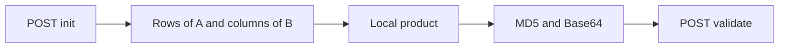

# Matrix multiplication — .NET client

The PDF asks for a client that walks the API, multiplies locally, and proves the result with a hash. The server ([swagger](https://takehome-api-231097775515.us-central1.run.app/swagger/v1/swagger.json)) is .NET: NSwag 14 + FastEndpoints, `int32` values. SDK available on this machine: **.NET 8.0.418** (22 cores, ~30 GB of RAM).

This stage covers the code, tests, README, timing log, and a Docker image so a reviewer can run the client without a local .NET SDK.

## What the API requires

- `POST /api/matrix/init` with `Content-Type: application/json` and `{"n": N}`. `N` is an integer from 1 to 10,000. Each init wipes the previous matrices.
- `GET /api/matrix/{A|B}/row/{i}` and `GET /api/matrix/{A|B}/column/{j}`, zero-based. No `Content-Type` and no body (otherwise 400).
- Fetch **all** required data **before** multiplying. Do not overlap fetch and the product.
- `POST /api/matrix/validate` with `{"hash": "<Base64 of the MD5 of the result>"}`. The response carries `result`.
- 429: wait and retry; the matrix stays. An error such as "Matrix not found", or a crash: call init again and fetch from scratch.

The sample screenshot (LINQPad, n = 1000) adds up exactly: Get 157 + Multiply 425 + Validate 1001 = Total 1583. Validate being slower than the entire fetch suggests the server **recomputes** A×B while validating. The timed run therefore targets **n = 1000** (the size in the instructions). The client still supports n up to 10,000, but the server-side validate may run out of time or memory.

## Fetch decision

C = A×B needs only the **n rows of A** and the **n columns of B**. That uses both route types, builds both matrices, and avoids doubling the traffic (4n requests). Also fetching A's columns and B's rows does not change the hash; it only adds latency and the chance of a 429.

The fetch finishes completely. Only then does multiplication start.



## Hash (not specified in the PDF)

The instructions only say: MD5 of the result, then Base64. The correct reading is `Convert.ToBase64String(MD5.HashData(bytes))` — the raw 16 bytes, not the hex string.

The byte layout is not documented. `--calibrate` (default n = 3) tries each candidate against the live API until `result` is a success. The candidates are:

- `int32` little-endian, row by row
- `int32` big-endian, row by row
- the same orders, column by column
- UTF-8 of the JSON `[[...],[...]]`
- UTF-8 of lines separated by commas or spaces
- UTF-8 of the whole product, row-major, joined by commas

The layout the API accepts is the last one: `CommaSeparated`. For the product `[[5148, 1460], [9396, 2275]]` the hashed text is `5148,1460,9396,2275`, with no trailing comma and no newline. That choice is fixed in `ResultHasher.DefaultLayout`. Multiplication stays `unchecked` (`int32` wrap). `--layout` can still force another candidate.

## Performance

The expected bottleneck from Brazil (high RTT to `us-central1`) is the 2,000 GETs for n = 1000, not the product.

- `SocketsHttpHandler` with HTTP/2, one connection, many streams.
- Adaptive concurrency (AIMD): every 16 successes raise the limit by 4, up to the ceiling; on 429, cut it in half and retry only the failed call, with jitter. Defaults are an initial limit of 64 and a ceiling of 128.
- Parse with `Utf8JsonReader` straight into a preallocated `int[]` (A row-major, B column-major). No intermediate `List<int>`.
- Blocked product with `Parallel.For` over row tiles of 64, column tiles of 64, and k tiles of 256. The inner kernel uses `Vector256<int>` when AVX2 is present.
- For n = 1000 (10^9 products) the local multiply target is to beat the sample's 425. Validate time includes server work and cannot be optimized on the client. Ten Docker runs on this machine all returned `Success`. The fastest total was Get 4230, Multiply 48, Validate 3596, Total 7874.

## Structure

A small solution, warnings as errors, nullable enabled:

- [`MatrixMultiply.sln`](MatrixMultiply.sln)
- [`src/MatrixMultiply.Core`](src/MatrixMultiply.Core) — HTTP client, orchestration, product, hash, retry policy
- [`Dockerfile`](Dockerfile) — multi-stage build. The SDK stage publishes the client; the `test` stage runs the unit tests; the final stage is `mcr.microsoft.com/dotnet/runtime:8.0`. [`.dockerignore`](.dockerignore) keeps `bin`, `obj`, and `artifacts` out of the context.
- [`src/MatrixMultiply.Cli`](src/MatrixMultiply.Cli) — published into that image. Arguments are the same ones the process accepts (`--n`, `--calibrate`, and the rest).
- [`tests/MatrixMultiply.Tests`](tests/MatrixMultiply.Tests) — known matrix product, JSON parser, 429 retry with a fake `HttpMessageHandler`, candidate hash layouts
- [`README.md`](README.md) in English (this is what the reviewers will read): how to run, decisions, and the submission checklist. The screenshot is done. GitHub and the email are still open.
- Console output in the shape of the sample: Init Message, Get A & B took, Multiply took, Validate Result, Validate took, Total took. The same text is written to `artifacts/timings.txt`. The n = 1000 run is in [artifacts/runtime-timings.png](artifacts/runtime-timings.png).

Configuration comes from arguments and `appsettings.json`. `BaseUrl` is fixed at `https://takehome-api-231097775515.us-central1.run.app` (no port).

## Run

Reviewers use Docker Desktop in Linux-container mode. The host does not need the .NET SDK.

```bash
docker build -t matrix-multiply .
docker run --rm -v "$PWD/artifacts:/app/artifacts" matrix-multiply --n 1000
docker run --rm matrix-multiply --calibrate
docker build --target test -t matrix-multiply-tests .
```

The volume writes `artifacts/timings.txt` on the host. `$PWD` expands in PowerShell, Git Bash, and WSL. In `cmd.exe` the same mount is `%cd%\artifacts:/app/artifacts`. A local .NET 8 SDK can still `dotnet test` and `dotnet run` as listed in the README.

## Verification

- `docker build --target test` passed 39 tests, with no dependency on the API.
- `--calibrate` against the API. `CommaSeparated` was accepted.
- `docker run` for n = 1000. `result` was `Success`, and the five measurements are in `artifacts/timings.txt` and [artifacts/runtime-timings.png](artifacts/runtime-timings.png).
